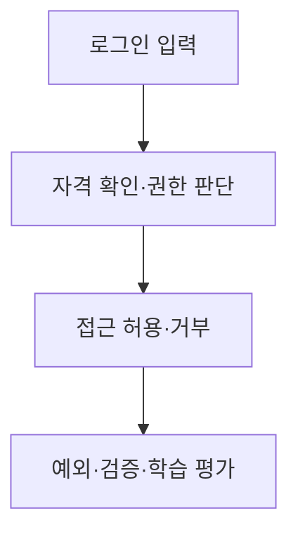

# B6-3 — 기술 학습 9요소 개요

> **PLAN_ONLY / NOT_VERIFIED.** 웹 로그인·인증·인가 분야의 용어·개념·아키텍처·주요 코드 학습을 위한 준비 문서입니다. 00단계 교육 계획과 실제 코드·실습 증빙을 혼동하지 않습니다.

## 1. 용어·개념 미리보기

| 순서 | 먼저 배울 기술 용어 | 이후 확인할 내용 |
|---|---|---|
| 1 | **Authentication** | 한글·영어 정의, 역할, 필요성, 예제, 반례 |
| 2 | **Authorization** | 한글·영어 정의, 역할, 필요성, 예제, 반례 |
| 3 | **Hash** | 한글·영어 정의, 역할, 필요성, 예제, 반례 |
| 4 | **Token** | 한글·영어 정의, 역할, 필요성, 예제, 반례 |
| 5 | **Session** | 한글·영어 정의, 역할, 필요성, 예제, 반례 |
| 6 | **Permission** | 한글·영어 정의, 역할, 필요성, 예제, 반례 |

**핵심 주제:** 웹 로그인·인증·인가. 학습자는 이 기술이 왜 필요한지, 다른 기술과 무엇이 다른지 설명할 수 있어야 합니다.

## 2. 개념 아키텍처 — 교육용 Mermaid

**주의:** 개념의 관계를 보여주는 **설명용 그림**입니다. 실제 시스템 설계는 03단계, 구현은 별도 승인 이후 04단계입니다.

## 3. 9가지 기술 학습 요소

| 교육 요소 | 이번 미션에서 준비할 학습 자료 |
|---|---|
| ① 용어 | Authentication·Authorization·Hash 등 한글/영어 정의 |
| ② 개념 | 왜 필요한지·작동 원리·선행 지식 |
| ③ 비유 | 일상 비유와 비유의 한계 |
| ④ 아키텍처 | 입력·처리·출력·실패·보안 경계 |
| ⑤ 주요 코드 | 로그인·권한·안전한 비밀 처리 (실제 코드는 04 승인 이후) |
| ⑥ 실행 흐름 | 예측→실행→상태·출력 변화 관찰 |
| ⑦ 오류 해결 | 재현·증거·원인·수정·재검증 |
| ⑧ 실습 | PRIMM(Predict·Run·Investigate·Modify·Make) |
| ⑨ 평가 | 공식 요구·학습 목표·L1~L5·독립 수행 |

## 4. 기존 단계 연결과 검증 경계

**00:** 개념 학습 계획 → **01:** 공식 요구와 평가 매핑 → **02:** 선행 학습 분석 → **03:** 실제 설계 → **04:** 별도 승인 후 새 코드 → **05~07:** 시험·증빙·숙달 검증 → **08:** 학습 슬라이드/실습자료 → **09:** 인계.

<ins>실제 코드 개발·실행·학습자 숙달은 아직 미실시입니다.</ins> 이전 Round의 코드·PASS는 참고만 하며 신규 미션 증빙으로 사용하지 않습니다.

[중앙 학습 표준](https://github.com/MetaStudy999/codyssey-basic/blob/main/standards/LEARNER-CENTERED-AI-LEARNING-STANDARD.md) · [미션 학습계획](LEARNING-SYSTEM-PLAN.md) · [00단계 README](README.md).

## 5. 한글·영어·공식 약어와 설명·재현 확인

**첫 표기:** 한글명(English Full Name, 공식 약어). 원래 약어가 없는 용어에는 새 약어를 만들지 않습니다.

| 한글명 | 영어 원명 | 공식·통용 약어 | 입문 설명 |
|---|---|---|---|
| **인증** | Authentication | 없음 | 이용자가 누구인지 확인 |
| **인가** | Authorization | 없음 | 해당 행동을 수행할 권한이 있는지 확인 |
| **역할 기반 접근 제어** | Role-Based Access Control | RBAC | 역할에 따라 접근 권한을 부여 |
| **해시** | Hash | 없음 | 일방향 해시 함수로 만든 결과 등 |

**자기 설명:** 인증(Authentication)은 이용자의 신원을 확인하는 단계이고, 인가(Authorization)는 특정 자료나 작업에 접근할 권한을 확인하는 단계입니다.

**종이 재현 예상 단계**
1. 이용자가 로그인을 요청했다고 가정.
2. 신원 확인 후 요청한 자원의 접근 권한 검사.
3. 권한에 따라 접근 허용 또는 거부를 예상.

**흔한 오해:** 로그인에 성공했다는 이유만으로 모든 자료를 열람·수정할 권한이 생기지 않습니다.

**학습 확인:** 핵심 용어를 직접 설명할 수 있나요? 입·처리·출력 순서를 자료 없이 다시 그릴 수 있나요? 실제 테스트 여부를 구별할 수 있나요?

**검증 구분:** 학습 설명·그림·예상 결과는 실제 새 코드·시험·학습자 숙달 결과가 아닙니다. **NOT_STARTED / NOT_VERIFIED**.
